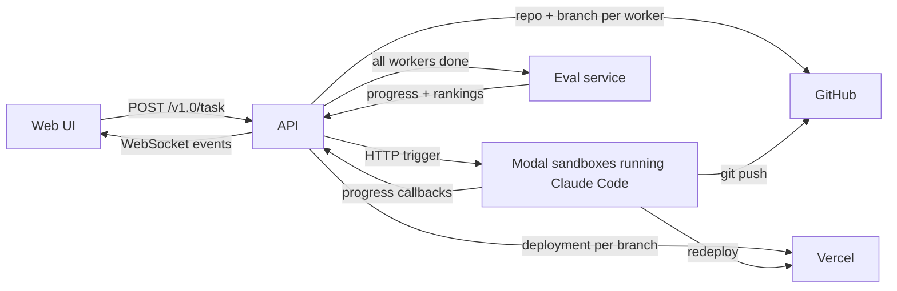

# TreeMux

TreeMux takes one task description and hands it to several AI coding agents at once. Each agent builds its own version of a web app in a cloud sandbox, pushes it to its own GitHub branch and gets its own Vercel deployment. When every agent is done, a panel of AI judges reviews the live sites (some judges use a real browser) and ranks them.

Built at TreeHacks 2026 as a team project.

## How it works



The project is four separate services: `api/` (the orchestrator), `worker/` (the coding sandboxes), `eval/` (the judges) and `web/` (the dashboard).

1. **Task submission.** The dashboard (`web/app/create/page.tsx`) sends a task to `POST /v1.0/task` on the API (`api/src/server.ts`). A task has a description, a number of workers, a short profile for each worker (for example "backend engineer focused on real-time sync"), an optional evaluator spec and a model name. The API returns a `taskId` right away and does the rest in the background.

2. **Repo and deployments.** `api/src/task.ts` sets up everything the workers need before any code is written:
   - `api/src/github.ts` creates one public repo for the task, then one branch per worker. GitHub creates the first commit of a new repo asynchronously, so branch creation retries until the default branch exists.
   - `api/src/vercel.ts` creates a Vercel deployment for each branch with `@vercel/sdk`, turns off deployment protection so the judges can open the sites, and copies the AI API keys into the Vercel project so the generated apps can call those APIs at runtime.
   - Every worker currently gets the task description as its "idea" plus a random risk and temperature value. `api/src/ideation.ts` contains an OpenRouter-based ideation step that would give each worker a different idea, but it is not wired into the task flow.

3. **Spawning workers.** `api/src/implementation-spawn.ts` sends one HTTP request per worker to the Modal endpoint in `worker/implementation_worker.py`. That endpoint returns immediately and starts `run_in_sandbox` in the background, which:
   - creates a Modal Sandbox from an Ubuntu image with Node.js, Bun, uv and the Claude Code CLI installed, running as a non-root `agent` user,
   - passes the job's settings (task id, branch, repo URL, tokens) in as a per-job Modal secret,
   - uploads `worker/runner.py`, the `treemux-report` tool and the files in `worker/skills/`, which go into `~/.claude/skills` as Claude Code skills (reference notes on shadcn/ui, the AI SDK, React best practices and so on that the agent can look up while it works).

   If `MODAL_IMPLEMENTATION_WORKER_URL` is not set, the API uses a mock worker instead that posts fake progress, which is useful for working on the UI.

4. **Building the app.** `worker/runner.py` runs inside the sandbox. It initializes git with the worker's branch and a push URL, writes a `.gitignore`, and writes a `vercel.json` that sets a `frame-ancestors *` header so the dashboard can show the deployed site in an iframe. Then it pipes the task into `claude -p` and adds a system prompt (`--append-system-prompt-file`) that explains the reporting tool, the default stack (Next.js and shadcn/ui with Bun), the rule that every setup command must be non-interactive, and a check to run before finishing (clean install and build). The CLI runs with permission prompts turned off, since nobody is there to approve them. It streams JSON events, which `implementation_worker.py` parses and logs as tool calls and results.

5. **Reporting progress.** The agent reports progress with `treemux-report` (`worker/scripts/treemux_report.py`), a small CLI installed in the sandbox:
   - `treemux-report start --idea ... --steps ...` saves the plan and posts it to `/v1.0/log/start`.
   - `treemux-report step --index N --summary ...` commits and force-pushes the code, posts to `/v1.0/log/step` and `/v1.0/log/push`, then triggers a fresh Vercel deployment and posts its URL to `/v1.0/log/deployment`.
   - `treemux-report done` reads the agent's `PITCH.md`, makes a final push and posts to `/v1.0/log/done`.

   Committing on every step means the branch, and so the live site, updates while the agent is still working. If the agent exits without calling `done`, the worker sends a failure callback itself so the API is never left waiting.

6. **Live updates.** Every callback is rebroadcast by `api/src/observability.ts` over a WebSocket at `/ws?taskId=...`. Clients subscribe per task, so a browser only gets events for the task it is watching. `web/hooks/useTaskStream.ts` turns those events into a node graph drawn with React Flow (`web/components/pipeline/`). The `/live` and `/judges` pages use a second path: the Next.js app has its own `/api/log/*` routes and an in-memory event store (`web/lib/store.ts`) that it streams to the browser with Server-Sent Events.

7. **Handing off to the judges.** The API counts finished jobs per repo. When the count reaches the number of workers it broadcasts `ALL_DONE`, and `api/src/eval-bridge.ts` opens a WebSocket to the eval service and sends each build's deployment URL, idea and pitch. Progress from the eval service is forwarded to the dashboard as it arrives.

8. **Judging.** The eval service (`eval/src/eval/server.ts`) checks the request with Zod, turns the evaluator spec into a short context document and puts the run on a queue that handles one evaluation at a time. The run (`eval/src/orchestrator-modal.ts`) goes through four phases:
   - **Plan.** A planner agent (`eval/src/agents/planner.ts`) designs the judging panel: judge personas, scoring categories with weights, and whether each judge needs a browser.
   - **Judge.** Each judge agent (`eval/src/agents/judge.ts`) scores one project per category with written reasoning. Judges run on the Claude Agent SDK. Browser judges get Stagehand tools (navigate, observe, extract, interact, screenshot) on a Browserbase browser, exposed as an in-process MCP server (`eval/src/tools/stagehand.ts`).
   - **Compute.** Plain code, no model calls. `eval/src/scoring/compute.ts` takes the weighted average of each judge's category scores. `eval/src/scoring/normalize.ts` converts each judge's scores to z-scores and maps them back onto a 1 to 10 scale, so a harsh judge and a generous judge count the same. `compute.ts` then averages the normalized judge scores (with optional per-judge weights) into one composite score per project. `eval/src/scoring/outliers.ts` flags projects that stand out overall, stand out in one category, or have an unusual score profile (cosine similarity).
   - **Report.** A report-writer agent (`eval/src/agents/report-writer.ts`) writes a feedback report for each project. The rankings and a markdown summary table (built in plain code by `writeRankingsSummary` in the same file) go back to the API over the WebSocket.

   In this mode each planner, judge and report task runs in its own Modal sandbox (`eval/src/modal/client.ts`). The sandboxes share a Modal volume for inputs, outputs and checkpoints, and report back to a small webhook server (`eval/src/modal/webhook-server.ts`) whose messages are signed with a per-run HMAC key (`eval/src/modal/hmac.ts`). The same pipeline can also run in a single process (`eval/src/orchestrator.ts`), which reuses a pool of browser sessions (`eval/src/tools/stagehand-pool.ts`) and saves checkpoints so an interrupted run can resume.

## Project layout

```
api/        Bun + TypeScript orchestrator: task API, GitHub/Vercel setup, worker spawning, WebSocket events
  assets/   default task prompt and sample worker profiles
worker/     Modal app that runs Claude Code in sandboxes
  scripts/  treemux-report, the progress CLI used inside the sandbox
  skills/   reference notes uploaded into each sandbox for Claude Code
eval/       judging service: planner, judge and report agents, scoring, Modal dispatch
  tests/    Vitest unit tests
web/        Next.js dashboard (task form, pipeline graph, live build view, results)
system-overview.drawio(.svg)   architecture diagram
```

## Tech stack

- TypeScript with Bun (API) and Node.js (eval service)
- Python, Modal and FastAPI (worker sandboxes and their HTTP trigger)
- Claude Code CLI (coding agents) and the Claude Agent SDK (judges)
- Browserbase and Stagehand (browser access for judges)
- GitHub REST API and the Vercel SDK (repos and deployments)
- Next.js, React, React Flow (`@xyflow/react`), Framer Motion and Tailwind CSS (dashboard)
- Zod (schema validation), Vitest (tests)

## Running it

You need Bun, Node.js, a Modal account with the `modal` CLI, a GitHub token with `repo` scope, a Vercel token, and an Anthropic API key or Claude Code OAuth token. The worker sandboxes call back to the API over HTTP, so the API has to be reachable from the internet (for example through ngrok) and that public URL goes in `CALLBACK_BASE_URL`.

**1. Deploy the worker to Modal.** The deploy prints the URL of the `trigger` endpoint.

```bash
cd worker
modal deploy implementation_worker.py
```

**2. Start the eval service (optional).** In server mode it runs the agents in Modal sandboxes, so the built code is uploaded to a Modal volume first. It also needs a Modal secret named `eval-agent-secrets` that holds `ANTHROPIC_API_KEY` (plus `BROWSERBASE_API_KEY` and `BROWSERBASE_PROJECT_ID` for browser judges).

```bash
cd eval
npm install
npm run deploy
PORT=3002 npm run server
npm test                         # unit tests
```

`npm run cli -- -c <config.json> --local` runs an evaluation from the command line instead, in a single process. Without `--local` the CLI uses the Modal sandboxes, and `--resume` picks up from the last checkpoint.

**3. Start the API.** Copy `api/.env.example` to `api/.env` and fill it in:

- `GITHUB_TOKEN` (needed to create the task repo), `GIT_USER_NAME` and `GIT_USER_EMAIL` (the commit author inside the sandboxes)
- `VERCEL_TOKEN` (without it, no deployments are created)
- `CLAUDE_CODE_OAUTH_TOKEN` and/or `ANTHROPIC_API_KEY` for Claude Code in the sandboxes
- `CALLBACK_BASE_URL`, the public URL of this API
- `MODAL_IMPLEMENTATION_WORKER_URL`, the URL from step 1 (without it, the mock worker runs)
- `EVAL_WS_URL`, for example `ws://localhost:3002/evaluate` (without it, judging is skipped)
- `OPENAI_API_KEY` and `OPENROUTER_API_KEY` are optional. They are passed to the sandboxes and to the Vercel projects so the generated apps can use them.

The dashboard expects the API on port 3001 by default.

```bash
cd api
bun install
PORT=3001 bun run start
```

**4. Start the dashboard.** Put `NEXT_PUBLIC_API_URL=http://localhost:3001` in `web/.env.local` (see `web/.env.example`).

```bash
cd web
bun install
bun run dev
```

Then open `http://localhost:3000/create`, or send a task straight to the API:

```bash
curl -X POST http://localhost:3001/v1.0/task \
  -H "Content-Type: application/json" \
  -d '{
    "taskDescription": "Build a real-time collaborative whiteboard app",
    "workers": 2,
    "workerDescriptions": [
      "Full-stack engineer specializing in React and WebSockets",
      "Backend engineer focused on scalability and real-time sync"
    ],
    "evaluator": { "count": 2, "role": "hackathon judge", "criteria": "novelty, feasibility, demo readiness" },
    "model": "sonnet"
  }'
```
